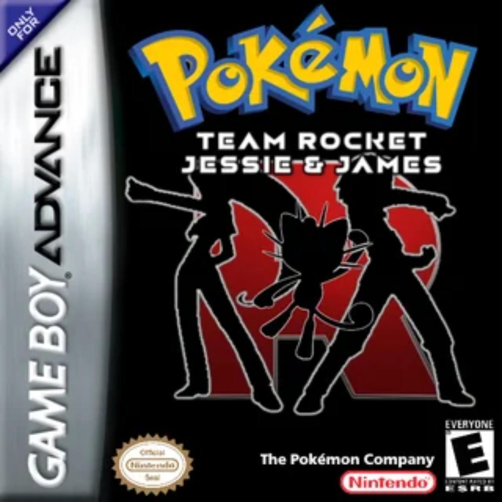

  

<h1 align="center">Pokémon Team Rocket: Jessie & James Edition</h1>

<strong>Unofficial English Translation</strong>

  <a href="https://xbaconator9000x.github.io/Unofficial-Jessie-James-Edition-English-Translation/"><strong>Visit the Team Rocket website</strong></a>
  &nbsp;|&nbsp;
  <a href="https://xbaconator9000x.github.io/Unofficial-Jessie-James-Edition-English-Translation/#releases"><strong>Patch your ROM</strong></a>
  &nbsp;|&nbsp;
  <a href="https://xbaconator9000x.github.io/Unofficial-Jessie-James-Edition-English-Translation/#spanish">Español QoL</a>
  &nbsp;|&nbsp;
  <a href="https://xbaconator9000x.github.io/Unofficial-Jessie-James-Edition-English-Translation/#changelog">Changelogs</a>
  &nbsp;|&nbsp;
  <a href="https://tally.so/r/M1N2oE">Submit a private bug report</a>

---

> **Downloads have been disabled for the time being, as per MrNightology's request**
>
> Both English and Spanish patch downloads are temporarily suspended. The website remains available for information, screenshots and credits.

## Releases

**English v1.03.2** -- 22 November 2026.

[View release information](https://xbaconator9000x.github.io/Unofficial-Jessie-James-Edition-English-Translation/#releases) (downloads suspended).

Choose your own matching original Spanish FINAL v1.1 ROM (16 MiB, CRC32 `805E24CA`), English v1.0 (`C043455C`), English v1.01 (`A3E3CC2F`), either English v1.02 build (`CADC8480` or `D2866130`), English v1.03 (`6E1E5095`) or the intermediate Aqua hotfix (`519E0696`). The browser patcher is temporarily disabled. The release details and compatibility information are retained for reference.

Expected English v1.03.2 output CRC32: `5DAE93EA`. The patcher handles earlier releases automatically, including both v1.02 builds and the v1.03 Aqua ship hotfix. The original Spanish ROM uses the complete v1.03.2 patch. Keep backups of your ROM and save. No pre-patched ROMs.

## Prefer to play español?

Si prefieres jugar a la versión original en español, he preparado otro parche para que también puedas disfrutar de las mejoras de calidad de vida que he añadido a mi versión inglesa, sin tener que jugar en inglés. El objetivo es mantener el juego de MrNightology en español y añadir esas mejoras, no hacer una nueva traducción.

**Modo difícil opcional** -- He escrito scripts propios para mejorar la IA de los entrenadores, he ampliado sus equipos y he dado más variedad a sus movimientos, sin subir los niveles ni imponer restricciones al jugador.

**Otras mejoras incluidas** -- Modos de combate Clásico y Moderno (con división físico/especial, habilidades actualizadas y MT reutilizables en Moderno), EXP. ALL opcional, estadísticas de naturaleza diferenciadas por colores, información de movimientos al pulsar L e indicadores de efectividad, Mentas de Naturaleza, Chapas Plateadas y Doradas, bayas que reducen los EV, los seis objetos Power para entrenar EV, lectores de EV e IV en la base del Team Rocket, mayor capacidad de la Mochila, Cuerda Huida reutilizable y precios de hasta cinco cifras.

[Ver las mejoras de la versión en español](https://xbaconator9000x.github.io/Unofficial-Jessie-James-Edition-English-Translation/#spanish) (descargas suspendidas).

Utiliza la ROM original FINAL v1.1 en español (CRC32 `805E24CA`), la versión española QoL v1.0 (`7C042814`) o cualquiera de las versiones QoL v1.02 (`0486144D` o `58F089B9`). El resultado QoL v1.03 permanece en español (CRC32 `222A0072`). El parche es independiente de la traducción inglesa. No envíes ROMs ni archivos de guardado.

## What is Jessie & James Edition?

*Pokémon Team Rocket: Jessie & James Edition* is an original FireRed-based game by MrNightology, first released in Spanish. You play as James alongside Jessie and Meowth.

After another failed attempt to steal Pikachu, a Delibird arrives with a message from Giovanni. The trio return to Kanto to carry out Team Rocket missions. Expect to steal Pokémon and items, investigate places and get in other people's way. I won't spoil the missions themselves.

The game covers **Kanto and Johto**. It also includes the Battle Subway, shop robberies, a day/night cycle, dynamic overworld palettes, a Black/White-style Repel system, Ruins of Alph puzzles, region-specific wild Pokémon music, extra trainer themes, expanded overworld and music tables, dynamic healing locations and VS bars.

[View MrNightology's original Spanish release](https://www.whackahack.com/juegos/pokemon-team-rocket-jessie-james/).

## Translation

This is my unofficial English translation of the completed v1.1 game. I'm not affiliated with the original developer.

I extracted the Spanish text and replaced matching FireRed lines with their official English versions. For the rest, I used Google Translate as a starting point, then went through the dialogue with the anime as a reference for the characters' voices. I also fixed text wrapping and page breaks where needed.

I also added optional gameplay features and quality-of-life changes, while keeping the original story intact.

### Quality of life

These are the gameplay options and conveniences I've added to the English release:

- **Classic / Modern battles** -- Choose the original Gen 3 battle mechanics or the physical/special split and updated ability effects. TMs remain single-use in Classic Mode and are reusable in Modern Mode.
- **Optional Hard Mode** -- Smarter trainer AI, revised teams and more strategic battles without simply raising enemy levels.
- **EXP. ALL** -- A Key Item that can be switched on or off.
- **Nature colours** -- Increased stats appear in red and decreased stats in blue on Pokémon summary screens.
- **Move details** -- Press L during move selection to see the description, power, accuracy and physical/special category.
- **Effectiveness indicators** -- See how effective a move will be against your opponent.
- **Nature Mints and Bottle Caps** -- Ways to adjust your Pokémon's nature and improve their IVs, including Gold Bottle Caps.
- **EV training items** -- EV-reducing berries and all six Power items: Power Anklet, Band, Belt, Bracer, Lens and Weight.
- **EV and IV readers** -- Available through the scientists at Rocket HQ.
- **Expanded Bag storage** -- More room for items.
- **Reusable Escape Rope** -- Now a Key Item.
- **Five-digit prices** -- The shop display supports larger prices.

### Other additions

I've also added a looping version of the Team Rocket motto theme to the title screen.

I haven't finished a full playthrough yet, so there may still be bugs or translation mistakes I've missed. If you find anything, please use the [bug report form](#testing-and-bug-reports). Screenshots and a `.sav` file are especially helpful.

## Original Spanish Screenshots

These are screenshots from MrNightology's original Spanish version, not the English translation.

  

Original Spanish release -- Battle Subway map

  

## Fan art and emulator box art

  

Download for use in emulators that use GBA cover art.

[Download artwork (ZIP)](https://xbaconator9000x.github.io/Unofficial-Jessie-James-Edition-English-Translation/media/jessie-james-fan-art-pack.zip)

Includes:
- GBA box art (JPG)
- Logo with Rocket R (WEBP)
- Logo without Rocket R (WEBP)

## Privacy and site statistics

The website records anonymous visits and counts when a verified patch or ROM download is **started**. Those counts aren't confirmed downloads or unique players. No ROMs, patches or save files are uploaded through the patcher. Details about the counters and their configuration are in [website maintenance](docs/WEBSITE_ANALYTICS.md).

## Testing and Bug Reports

Testing is still ongoing. There's a lot of conditional dialogue and one-off events, so there may still be untranslated lines, odd wording, text errors or bugs that only show up under certain conditions.

If you find something, [submit a private bug report](https://tally.so/r/M1N2oE). Screenshots or a short video help, especially if you can include the location, emulator, patch version and how to reproduce it.

No sign-in or personal details needed. Reports and attachments aren't public. Please don't upload ROMs or patches.

## Changelog

### English v1.03 -- 22 November 2026

- Expanded bag item storage
- Escape rope is now a reuseable key item
- Added Power items for EV training (Power Anklet, Band, Belt, Bracer, Lens, and Weight)
- Fixed EV/IV reader glitch
- Repaired movement pointer/dialogue overlap which would cause CTD.

### English v1.02 -- 21 November 2026

- Translated additional hidden Spanish dialogue
- Fixed pick-up table bug
- Repaired text wrapping issues
- Updated move description text wrapping
- Restored native English localisation to items
- Translated trainer names and classes to English localisation standards
- Added Oak battle to boss pool for improved combat AI in HARD mode.
- Location and reference localisation fixes
- Prices tweaked for Modern mode reuseable TMs
- Prices tweaked for vitamins
- **MAJOR QOL additions:**
  - Nature mints
  - Bottle caps and Golden bottle caps
  - Restored function to EV berries
  - IV and EV readers (Rocket HQ Scientists)
  - Expanded price list to five-digits

### English v1.01 -- 20 November 2026

- Fixed graphical issue during blast-off sequence
- Corrected byte allocation overlap for EXP. ALL and Hard mode
- Corrected game-breaking freeze in Oak's lab.

### English v1.0 -- 20 November 2026

- Initial public English translation release.
- English dialogue, menus and text formatting.
- Classic and Modern battle options, nature colours, move details and effectiveness indicators, and title music.

[Release history and patcher](https://xbaconator9000x.github.io/Unofficial-Jessie-James-Edition-English-Translation/#changelog).

## Credits

Full credit for the original game, story, maps, artwork and gameplay goes to **MrNightology and the original project's contributors**. The game was translated without author consultation.

English localisation and patcher maintenance -- [@xbaconator9000x](https://github.com/xbaconator9000x).

Box art and logos -- **u/SnowMudK99**, used with permission.

Small Team Rocket R icons and the website favicon are sourced from [Wikimedia Commons](https://commons.wikimedia.org/wiki/File:Team_Rocket_Logo.svg). Original Spanish screenshots are from [MrNightology's release](https://www.whackahack.com/juegos/pokemon-team-rocket-jessie-james/).

