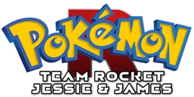

  

<h1 align="center">Pokémon Team Rocket: Jessie & James Edition</h1>

<strong>Quality of Life (QoL) &amp; English Localisation</strong>

  <a href="https://xbaconator9000x.github.io/Unofficial-Jessie-James-Edition-English-Translation/"><strong>Visit the Team Rocket website</strong></a>
  &nbsp;|&nbsp;
  <a href="https://xbaconator9000x.github.io/Unofficial-Jessie-James-Edition-English-Translation/#official"><strong>Official English QoL</strong></a>
  &nbsp;|&nbsp;
  <a href="https://xbaconator9000x.github.io/Unofficial-Jessie-James-Edition-English-Translation/#releases"><strong>Unofficial English</strong></a>
  &nbsp;|&nbsp;
  <a href="https://xbaconator9000x.github.io/Unofficial-Jessie-James-Edition-English-Translation/#spanish">Español QoL</a>
  &nbsp;|&nbsp;
  <a href="#two-english-versions">Two English Versions?</a>
  &nbsp;|&nbsp;
  <a href="https://xbaconator9000x.github.io/Unofficial-Jessie-James-Edition-English-Translation/#changelog">Changelogs</a>
  &nbsp;|&nbsp;
  <a href="https://tally.so/r/M1N2oE">Submit a private bug report</a>

---

> **Downloads have been reinstated.** The official English translation by [RasenVolt](https://x.com/RasenVolt) is now out, and all three v1.04 patches are available.

## Releases

**v1.04 -- 28 November 2026**

There are now three separate patches. Choose the one that matches the ROM you want to play.

| Edition | Required base ROM | BPS patch | Browser patcher |
| --- | --- | --- | --- |
| **Official English QoL v1.04** | RasenVolt's official English v1.1 (`9ED6BE84`) | [Download](downloads/jessie-james-official-english-qol-v1.04-ef0bb0a2.bps) | [Official English QoL](https://xbaconator9000x.github.io/Unofficial-Jessie-James-Edition-English-Translation/#official) |
| **Unofficial English v1.04** | Spanish FINAL v1.1 (`805E24CA`) or supported earlier unofficial English versions | [Download full patch](downloads/jessie-james-english-v1.04-43caa1f3.bps) | [Unofficial English](https://xbaconator9000x.github.io/Unofficial-Jessie-James-Edition-English-Translation/#releases) |
| **Spanish QoL v1.04** | Spanish FINAL v1.1 (`805E24CA`) or supported earlier Spanish QoL versions | [Download full patch](downloads/jessie-james-spanish-qol-v1.04-1c4a1771.bps) | [Español QoL](https://xbaconator9000x.github.io/Unofficial-Jessie-James-Edition-English-Translation/#spanish) |

The full BPS patches are for the original ROMs listed above. If you're updating an earlier patched version, use the appropriate browser patcher or see the [v1.04 release notes and incremental patches](docs/RELEASE-v1.04.md).

The official English QoL patch does **not** contain my unofficial translation. It retains RasenVolt's dialogue, original translation scripting and splash screen, with my QoL features, applicable fixes and Team Rocket theme music added. You'll need to get the [official English release](https://x.com/TeamRocketGBA/status/2126289020783096072?a=-cS06P4WTo4NdA5naok&s=19) first.

The output CRC32 values are `EF0BB0A2` (official English QoL), `43CAA1F3` (unofficial English) and `1C4A1771` (Spanish QoL). The browser patchers verify compatibility and apply the patch locally on your device. Keep backups of your original ROM and save. No pre-patched ROMs are distributed here.

## Prefer to play español?

Si prefieres jugar a la versión original en español, he preparado otro parche para que también puedas disfrutar de las mejoras de calidad de vida que he añadido a mi versión inglesa, sin tener que jugar en inglés. El objetivo es mantener el juego de MrNightology en español y añadir esas mejoras, no hacer una nueva traducción.

**Modo difícil opcional** -- He escrito scripts propios para mejorar la IA de los entrenadores, he ampliado sus equipos y he dado más variedad a sus movimientos, sin subir los niveles ni imponer restricciones al jugador.

**Otras mejoras incluidas** -- Modos de combate Clásico y Moderno (con división físico/especial, habilidades actualizadas y MT reutilizables en Moderno), EXP. ALL opcional, estadísticas de naturaleza diferenciadas por colores, información de movimientos al pulsar L e indicadores de efectividad, Mentas de Naturaleza, Chapas Plateadas y Doradas, bayas que reducen los EV, los seis objetos Power para entrenar EV, lectores de EV e IV en la base del Team Rocket, mayor capacidad de la Mochila y precios de hasta cinco cifras.

Novedades de v1.04: correcciones de errores, mejoras de IA y clases de entrenadores, restauración de la localización oficial en español de textos de movimientos, habilidades, Pokédex y mensajes de combate, y correcciones de los gráficos de la interfaz. Los textos originales de MrNightology se mantienen.

[Ver las mejoras de la versión en español](https://xbaconator9000x.github.io/Unofficial-Jessie-James-Edition-English-Translation/#spanish).

Utiliza la ROM original FINAL v1.1 en español (CRC32 `805E24CA`), la versión española QoL v1.0 (`7C042814`), cualquiera de las versiones QoL v1.02 (`0486144D` o `58F089B9`) o la versión QoL v1.03 (`222A0072`). El resultado QoL v1.04 permanece en español (CRC32 `1C4A1771`). El parche es independiente de la traducción inglesa. No envíes ROMs ni archivos de guardado.

## What is Jessie & James Edition?

*Pokémon Team Rocket: Jessie & James Edition* is an original FireRed-based game by MrNightology, first released in Spanish. You play as James alongside Jessie and Meowth.

After another failed attempt to steal Pikachu, a Delibird arrives with a message from Giovanni. The trio return to Kanto to carry out Team Rocket missions. Expect to steal Pokémon and items, investigate places and get in other people's way. I won't spoil the missions themselves.

The game covers **Kanto and Johto**. It also includes the Battle Subway, shop robberies, a day/night cycle, dynamic overworld palettes, a Black/White-style Repel system, Ruins of Alph puzzles, region-specific wild Pokémon music, extra trainer themes, expanded overworld and music tables, dynamic healing locations and VS bars.

[View MrNightology's original Spanish release](https://www.whackahack.com/juegos/pokemon-team-rocket-jessie-james/).

## Two English Versions?

There are two English releases for Pokémon Team Rocket: Jessie & James Edition. My [Unofficial English Translation](https://xbaconator9000x.github.io/Unofficial-Jessie-James-Edition-English-Translation/#releases), which was released on 17/11/2026, and the [Official English Translation](https://x.com/TeamRocketGBA/status/2126289020783096072?a=-cS06P4WTo4NdA5naok&s=19) by [RasenVolt](https://x.com/RasenVolt), which was released on 27/11/2026.

I created my version without explicit permission from MrNightology. I started development in June 2026, prior to the official Spanish v1.1 release. I attempted to get approval from MrNightology very late in development, but when I didn't hear back from him, I went ahead and released my patch anyway. However, MrNightology requested that I not proceed with the release, as RasenVolt was already working on the official translation. Unfortunately, I had already published my translation by the time I saw his request. As such, I suspended downloads for my unofficial English translation until after RasenVolt's official translation was released.

Now that the official translation has been released, I've added support for it so that players can enjoy my original Quality of Life (QoL) improvements in the official release! I've since reinstated downloads for my unofficial English translation.

### Which version is better?

The official translation by RasenVolt is <strong><u>the definitive release</u></strong> of MrNightology's original game! It follows the original Spanish text precisely and preserves MrNightology's intent in its wording and characterisation.

The unofficial translation takes more liberties with the characters' voices. As someone who isn't fluent in Spanish, I took heavy inspiration from the anime to guide my translation and interpretation of the characters. The result is that the voices of the core characters in the game are heavily inspired by their characterisation in the English anime, in a way that the official translation doesn't replicate, for better or worse. This also means that my translation may deviate from some of MrNightology's original intent and characterisation.

But which version is better? That comes down to personal taste. If you're unsure, I suggest you go with the official release, as it captures the developer's vision far more accurately than my translation.

## Quality of life and translation

With v1.04, I've adapted my QoL features and bug fixes for RasenVolt's official English translation, as well as updating my unofficial English translation and the Spanish QoL patch. I'm not affiliated with the original developer.

For my unofficial English version, I extracted the Spanish text and replaced matching FireRed lines with their official English versions. For the rest, I used Google Translate as a starting point, then went through the dialogue with the anime as a reference for the characters' voices. I also fixed text wrapping and page breaks where needed.

### Quality of life

These are the gameplay options and conveniences I've added across all three editions:

- **Classic / Modern battles** -- Choose the original Gen 3 battle mechanics or the physical/special split and updated ability effects. TMs remain single-use in Classic Mode and are reusable in Modern Mode.
- **Optional Hard Mode** -- Smarter trainer AI, revised teams and more strategic battles without simply raising enemy levels.
- **EXP. ALL** -- A Key Item that can be switched on or off.
- **Nature colours** -- Increased stats appear in red and decreased stats in blue on Pokémon summary screens.
- **Move details** -- Press L during move selection to see the description, power, accuracy and physical/special category.
- **Effectiveness indicators** -- See how effective a move will be against your opponent.
- **Nature Mints and Bottle Caps** -- Ways to adjust your Pokémon's nature and improve their IVs, including Gold Bottle Caps.
- **EV training items** -- EV-reducing berries and all six Power items: Power Anklet, Band, Belt, Bracer, Lens and Weight.
- **EV and IV readers** -- Available through the scientists at Rocket HQ.
- **Expanded Bag storage** -- More room for items.
- **Five-digit prices** -- The shop display supports larger prices.

### Other additions

I've also added a looping version of the Team Rocket motto theme to the title screen.

I haven't finished a full playthrough yet, so there may still be bugs or translation mistakes I've missed. If you find anything, please use the [bug report form](#testing-and-bug-reports). Screenshots and a `.sav` file are especially helpful.

## Original Spanish Screenshots

These are screenshots from MrNightology's original Spanish version, not the English translation.

  

Original Spanish release -- Battle Subway map

  

## Fan art and emulator box art

  

Download for use in emulators that use GBA cover art.

[Download artwork (ZIP)](https://xbaconator9000x.github.io/Unofficial-Jessie-James-Edition-English-Translation/media/jessie-james-fan-art-pack.zip)

Includes:
- GBA box art (JPG)
- Logo with Rocket R (WEBP)
- Logo without Rocket R (WEBP)

## Privacy and site statistics

The website records anonymous visits and counts when a verified patch or ROM download is **started**. Those counts aren't confirmed downloads or unique players. No ROMs, patches or save files are uploaded through the patcher. Details about the counters and their configuration are in [website maintenance](docs/WEBSITE_ANALYTICS.md).

## Testing and Bug Reports

Testing is still ongoing. There's a lot of conditional dialogue and one-off events, so there may still be untranslated lines, odd wording, text errors or bugs that only show up under certain conditions.

If you find something, [submit a private bug report](https://tally.so/r/M1N2oE). Screenshots or a short video help, especially if you can include the location, emulator, patch version and how to reproduce it.

No sign-in or personal details needed. Reports and attachments aren't public. Please don't upload ROMs or patches.

## Changelog

### QoL / Translation v1.04 -- 28 November 2026

- Support for the official English translation by RasenVolt. All previous QoL features and applicable bug fixes are included; the official translation and original splash screen are retained, with the Team Rocket theme music.
- Unofficial English translation:
  - Additional bug fixes
  - Additional line wrapping fixes
  - Trainer AI enhancements
  - Trainer class reclassifications
- Spanish QoL:
  - Restored official Spanish localisation for previously English text, including moves, abilities, Pokédex entries and battle messages. MrNightology’s original Spanish text remains unchanged.
  - Repaired UI graphics to use official Spanish localisation.
- Applicable bug fixes, trainer AI improvements and previous QoL features are included across all three editions.

[Full v1.04 changelog and incremental download links](docs/RELEASE-v1.04.md#changelog).

### English v1.03 -- 22 November 2026

- Expanded bag item storage
- Added Power items for EV training (Power Anklet, Band, Belt, Bracer, Lens, and Weight)
- Fixed EV/IV reader glitch
- Repaired movement pointer/dialogue overlap which would cause CTD.

### English v1.02 -- 21 November 2026

- Translated additional hidden Spanish dialogue
- Fixed pick-up table bug
- Repaired text wrapping issues
- Updated move description text wrapping
- Restored native English localisation to items
- Translated trainer names and classes to English localisation standards
- Added Oak battle to boss pool for improved combat AI in HARD mode.
- Location and reference localisation fixes
- Prices tweaked for Modern mode reuseable TMs
- Prices tweaked for vitamins
- **MAJOR QOL additions:**
  - Nature mints
  - Bottle caps and Golden bottle caps
  - Restored function to EV berries
  - IV and EV readers (Rocket HQ Scientists)
  - Expanded price list to five-digits

### English v1.01 -- 20 November 2026

- Fixed graphical issue during blast-off sequence
- Corrected byte allocation overlap for EXP. ALL and Hard mode
- Corrected game-breaking freeze in Oak's lab.

### English v1.0 -- 17 November 2026

- Initial public English translation release.
- English dialogue, menus and text formatting.
- Classic and Modern battle options, nature colours, move details and effectiveness indicators, and title music.

[Release history and patcher](https://xbaconator9000x.github.io/Unofficial-Jessie-James-Edition-English-Translation/#changelog).

## Credits

Full credit for the original game, story, maps, artwork and gameplay goes to **MrNightology and the original project's contributors**. My unofficial translation was made without explicit permission from the original developer.

Official English translation -- [RasenVolt](https://x.com/RasenVolt). [Official English release](https://x.com/TeamRocketGBA/status/2126289020783096072?a=-cS06P4WTo4NdA5naok&s=19).

Unofficial English localisation and patcher maintenance (including QoL additions) -- [@xbaconator9000x](https://github.com/xbaconator9000x).

Box art and logos -- **u/SnowMudK99**, used with permission.

Unofficial fan project. Not endorsed by the original developer.

Small Team Rocket R icons and the website favicon are sourced from [Wikimedia Commons](https://commons.wikimedia.org/wiki/File:Team_Rocket_Logo.svg). Original Spanish screenshots are from [MrNightology's release](https://www.whackahack.com/juegos/pokemon-team-rocket-jessie-james/).

